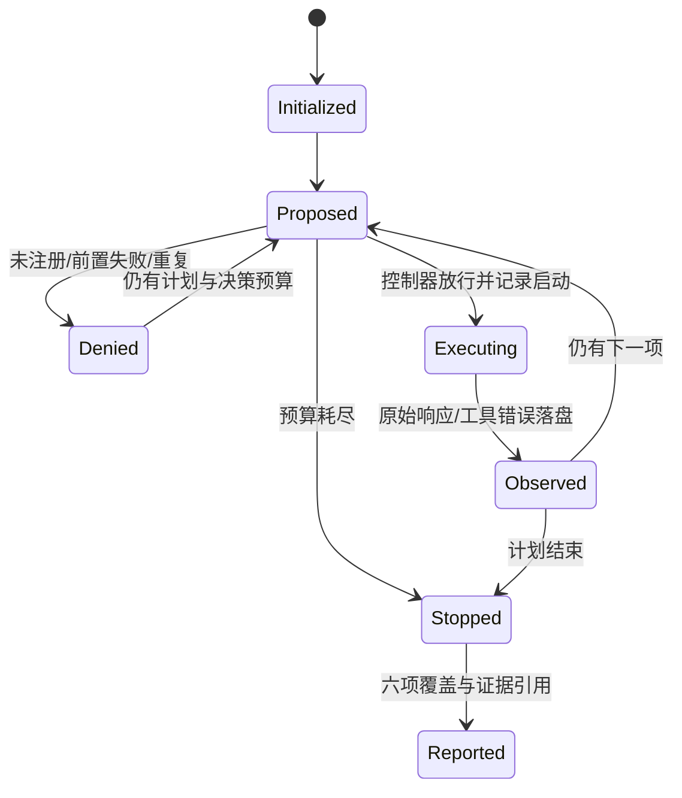

# 状态与边界

任何阶段写证据失败或 Ctrl+C 均中断，目录可能不完整，不作为验收成功。动作执行后才增加逻辑耗时；90 秒耗时的 T01 超时使用一次尝试，之后不启动 T06。单并发，无自动重试或恢复未完成 run。

业务凭据 revoked_A 只属于 T05 的模拟输入；测试任务授权在本基线运行期间固定。CH01 将增加可信授权事件，必须作为版本化变更审查，不得把当前静态目标注册表宣称为实时撤权。

三个不变量与开题卡一致：注册外不执行；证据不足不通过；停止后不启动新动作。NOT_RUN/DENIED 与 INCONCLUSIVE 是不同维度，报告同时保留。
